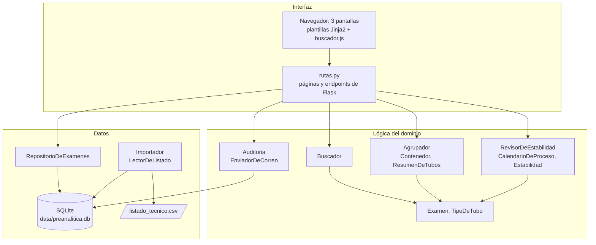

# Arquitectura y diseño

## Vista general

Preanalítica es una aplicación web local con tres capas. Cada capa solo conoce
a la de abajo:

## Componentes y responsabilidades

| Componente | Archivo | Responsabilidad |
|---|---|---|
| Rutas | `rutas.py` | Recibir lo que hace la enfermera, pedir los datos al repositorio, llamar a la lógica y mostrar la pantalla. No contiene reglas clínicas ni SQL |
| Examen, TipoDeTubo | `examen.py`, `tubos.py` | Representar un examen del listado y los tipos de tubo con su orden CLSI |
| Buscador | `buscador.py` | Encontrar exámenes tolerando errores de tipeo y sin importar tildes |
| Agrupador, Contenedor, ResumenDeTubos | `agrupador.py` | Aplicar las reglas de agrupación de tubos, las excepciones y el orden CLSI |
| RevisorDeEstabilidad, CalendarioDeProceso, Estabilidad, RevisionDeDerivacion | `derivaciones.py` | Calcular el día de proceso de los exámenes derivados y si la estabilidad alcanza |
| Auditoria, EnviadorDeCorreo, CorreoDePrueba, CorreoSMTP | `auditoria.py` | Registrar cada consulta y enviar el historial semanal |
| RepositorioDeExamenes | `repositorio.py` | Leer los exámenes de la base de datos |
| Importador, LectorDeListado, LectorDeListadoCSV | `importador.py` | Leer el listado técnico, cargarlo en la base y generar los reportes de revisión |
| Base de datos | `modelos.py` | Crear las tablas SQLite |

## Patrones de diseño

| Patrón | Dónde | Por qué aporta al proyecto |
|---|---|---|
| **Repositorio** | `RepositorioDeExamenes` | Las rutas piden exámenes sin escribir SQL. Si la base de datos cambia, solo cambia el repositorio |
| **Strategy** | `EnviadorDeCorreo` con `CorreoDePrueba` y `CorreoSMTP` | El prototipo debe probarse sin enviar correos reales. `Auditoria` funciona igual con cualquiera de los dos; en las pruebas se usa un enviador falso |
| **Strategy** | `LectorDeListado` con `LectorDeListadoCSV` | El listado llegó en CSV, pero podría llegar en Excel o PDF. Un formato nuevo es un lector nuevo; el `Importador` no cambia |
| **Application Factory** | `create_app()` en `__init__.py` | Las pruebas crean una app nueva con una base de datos temporal, sin tocar la base real |

## Principios SOLID aplicados

| Principio | Cómo se aplica |
|---|---|
| **S** · Responsabilidad única | Cada clase tiene un solo trabajo: `Buscador` busca, `Agrupador` agrupa, `RevisorDeEstabilidad` revisa estabilidad, `RepositorioDeExamenes` lee la base. Cuando el tecnólogo médico cambia una regla de tubos, solo cambia `Agrupador` |
| **O** · Abierto/cerrado | Para leer el listado en Excel se agrega un `LectorDeListadoExcel`; para otro canal de aviso, otro `EnviadorDeCorreo`. Se extiende sin modificar `Importador` ni `Auditoria` |
| **L** · Sustitución de Liskov | `CorreoDePrueba` y `CorreoSMTP` se pueden usar uno en lugar del otro: tienen el mismo método `enviar` y, si fallan, ambos lanzan `ErrorDeEnvio` |
| **I** · Segregación de interfaces | Las interfaces son pequeñas: `EnviadorDeCorreo` solo pide `enviar`, `LectorDeListado` solo pide `leer` |
| **D** · Inversión de dependencias | `Auditoria.envio_semanal` recibe "un enviador" (la abstracción `EnviadorDeCorreo`) y no depende de SMTP. `Importador` recibe "un lector" |

## Decisiones de diseño

- **Reglas clínicas aisladas de la interfaz.** Todas las reglas definidas por el tecnólogo médico viven en la capa de lógica, en clases que se prueban sin abrir el navegador.
- **El listado se importa una vez y la app solo lee la base.** Así, un listado dañado nunca deja la app a medias: si la importación falla, la base anterior sigue intacta.
- **Ante la duda, advertir.** Cuando un dato no se puede leer con seguridad (tubo, día de proceso, estabilidad), las clases devuelven "dato no disponible" en vez de suponer.
- **Pocas librerías y justificadas:** Flask, rapidfuzz (búsqueda), holidays (feriados), python-dotenv (configuración) y pytest.

Los diagramas UML detallados están en `docs/uml/`.
