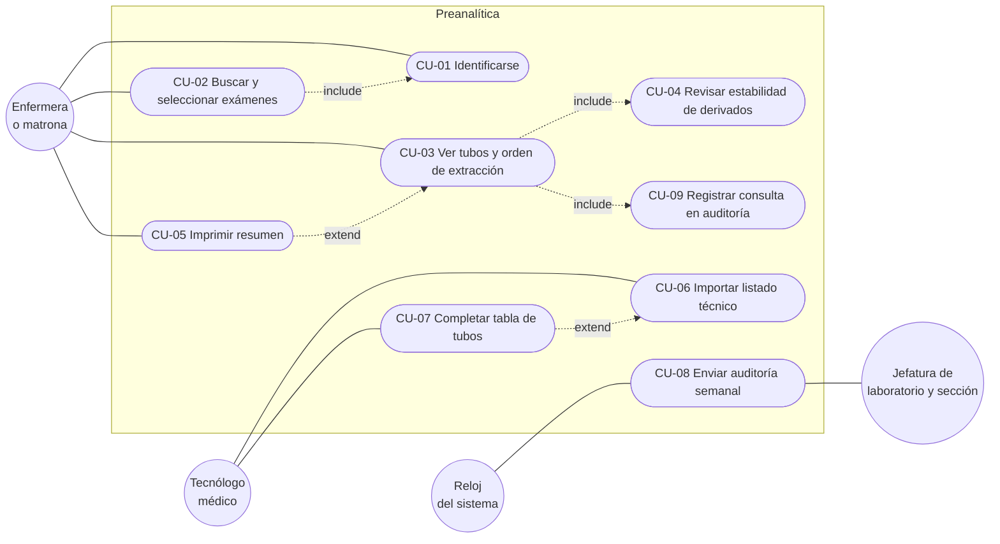

# Casos de uso

## Diagrama de casos de uso

Mermaid no tiene un tipo propio para casos de uso; se representan con un
diagrama de flujo: los actores son círculos, los casos de uso son óvalos dentro
del sistema, y las flechas punteadas son relaciones `include` o `extend`.

## Relación con los requisitos

| Caso de uso | Requisito (docs/requisitos.md) |
|---|---|
| CU-01 Identificarse | RF-1 |
| CU-02 Buscar y seleccionar exámenes | RF-2 |
| CU-03 Ver tubos y orden de extracción | RF-3, RF-5 |
| CU-04 Revisar estabilidad de derivados | RF-4 |
| CU-05 Imprimir resumen | RF-5 |
| CU-06 Importar listado técnico | RF-7 |
| CU-07 Completar tabla de tubos | RF-7 |
| CU-08 Enviar auditoría semanal | RF-6 |
| CU-09 Registrar consulta en auditoría | RF-6 |

## Casos de uso desarrollados

### CU-02 Buscar y seleccionar exámenes

- **Actor:** enfermera o matrona.
- **Requisito:** RF-2.
- **Precondición:** la enfermera se identificó (CU-01) y hay un listado cargado.
- **Flujo principal:**
  1. La enfermera escribe parte del nombre del examen, con o sin tildes.
  2. El sistema busca entre los exámenes del listado y muestra hasta 8 sugerencias, cada una con si se procesa en el recinto o se deriva.
  3. La enfermera elige una sugerencia con un clic, o con las flechas y Enter.
  4. El sistema agrega el examen a la lista de seleccionados.
  5. Se repite desde el paso 1 hasta tener todos los exámenes de la indicación.
- **Flujos alternativos:**
  - 1a. Escribe menos de 2 letras: el sistema pide al menos 2 y no busca.
  - 2a. Nada se parece lo suficiente: el sistema avisa que no encontró exámenes parecidos.
  - 3a. Presiona Enter sin marcar una sugerencia: no se agrega nada (el sistema nunca elige solo).
  - 4a. El examen ya estaba agregado: la sugerencia dice "Ya agregado" y no se repite.
  - 4b. La enfermera quita un examen de la lista con "Quitar".
- **Postcondición:** la selección queda en la sesión, lista para ver los tubos.

### CU-03 Ver tubos y orden de extracción

- **Actor:** enfermera o matrona.
- **Requisitos:** RF-3, RF-5.
- **Precondición:** hay al menos un examen seleccionado.
- **Flujo principal:**
  1. La enfermera presiona "Ver qué tubos usar".
  2. El sistema obtiene los exámenes seleccionados.
  3. El sistema agrupa los exámenes en tubos: comparten tubo los del mismo tipo y el mismo laboratorio.
  4. El sistema ordena los tubos según CLSI y los numera.
  5. El sistema revisa la estabilidad de cada examen derivado (CU-04).
  6. El sistema registra la consulta en la auditoría (CU-09).
  7. El sistema muestra el total de tubos, los tubos en orden, los avisos, las otras muestras y los exámenes derivados.
- **Flujos alternativos:**
  - 3a. Un examen admite varios tubos: se elige el que permite juntarlo con otro examen; si ninguno lo permite, el primero.
  - 3b. Hemocultivo o gases: van en su propio contenedor; los gases arteriales quedan como punción aparte.
  - 3c. El tubo no está disponible: el examen aparece con "Tubo: dato no disponible, consulte con el laboratorio".
  - 3d. La muestra no es sangre: el examen aparece en "Otras muestras".
  - 6a. La enfermera recarga la pantalla con los mismos exámenes: no se registra de nuevo.
- **Postcondición:** la consulta queda registrada en la auditoría, sin datos del paciente.

### CU-06 Importar listado técnico

- **Actor:** tecnólogo médico (o la persona a cargo del sistema).
- **Requisito:** RF-7.
- **Precondición:** el listado está en `data/listado_tecnico.csv`, sin haber sido guardado con Excel.
- **Flujo principal:**
  1. El actor ejecuta `flask --app app importar data/listado_tecnico.csv`.
  2. El sistema lee el archivo, encuentra la fila de títulos y ubica cada columna por su nombre.
  3. El sistema reconoce el tubo de cada examen y si se procesa en el recinto.
  4. El sistema aplica lo que el tecnólogo médico completó en la tabla de tubos (CU-07).
  5. El sistema reemplaza los exámenes de la base de datos.
  6. El sistema genera el reporte de revisión y la tabla de tubos por revisar.
  7. El sistema muestra solo conteos en la consola.
- **Flujos alternativos:**
  - 2a. No encuentra la fila de títulos o falta una columna: se detiene con un mensaje claro y no cambia la base.
  - 2b. Una fila con "Lab. Derivado" no numérico: se excluye y se anota en el reporte.
  - 3a. El tubo no se reconoce con seguridad: queda como "dato no disponible" y pasa a la tabla de tubos por revisar.
- **Postcondición:** la base tiene el listado nuevo y el tecnólogo médico tiene los reportes para validar.

### CU-08 Enviar auditoría semanal

- **Actor principal:** reloj del sistema. **Actor secundario:** jefatura de laboratorio y de sección.
- **Requisito:** RF-6.
- **Precondición:** es lunes o después, y la semana anterior todavía no se ha enviado.
- **Flujo principal:**
  1. Al recibir una consulta, el sistema revisa si corresponde enviar la auditoría.
  2. En segundo plano, exporta a un CSV el historial anterior a esta semana.
  3. Envía el CSV por correo a la jefatura.
  4. Borra de la base el historial enviado y anota la semana como enviada.
- **Flujos alternativos:**
  - 3a. Modo prueba: en vez de enviar, guarda el correo como archivo `.eml`.
  - 3b. El correo falla: no se borra nada y se reintenta una hora después.
  - 1a. Envío manual: el actor ejecuta `flask --app app auditoria-semanal`.
- **Postcondición:** la jefatura recibe el historial y la base queda sin ese historial; el CSV se conserva como respaldo.
