# Diagrama de clases

Clases del dominio y de los servicios de Preanalítica. Los nombres de clases,
atributos y métodos son los mismos del código (`app/`). Los métodos que
empiezan con `_` son de uso interno de la clase.

GitHub dibuja el diagrama automáticamente a partir del texto.

```mermaid
classDiagram
    direction TB

    class Examen {
        +int id
        +str nombre
        +str laboratorio
        +bool se_procesa_en_recinto
        +str tubos
        +str muestra
        +str instrucciones
        +str dias_proceso
        +str tiempo_respuesta
        +str estabilidad
        +desde_fila(fila)$ Examen
        +es_derivado() bool
        +es_otra_muestra() bool
        +opciones_de_tubo() list
        +etiqueta() dict
        +ayuno() list
        +luz() list
    }

    class TipoDeTubo {
        +str codigo
        +str nombre
        +int orden
        +bool exclusivo
        +es_puncion_aparte() bool
    }

    class Contenedor {
        +int cantidad
        +str laboratorio
        +bool en_recinto
        +int numero
        +agregar(examen)
        +nombre_tubo() str
        +orden() int
        +proteger_luz() bool
    }

    class ResumenDeTubos {
        +total_tubos() int
        +total_punciones_aparte() int
        +examenes_con_ayuno() list
    }

    class Agrupador {
        +agrupar(examenes) ResumenDeTubos
        -_poner_en_tubo(examen, tipo, cantidad)
        -_tubos_nuevos(opcion, laboratorio) int
        -_es_compartible(tipo, cantidad, laboratorio) bool
    }

    class CalendarioDeProceso {
        +str texto
        +set dias
        +es_segun_demanda() bool
        +se_entiende() bool
        +describir() str
        +dia_de_proceso(ahora) date
        +sugerir_dias_de_toma(ahora, horas_estabilidad) list
    }

    class Estabilidad {
        +str texto
        +dict duraciones
        +de_examen(examen)$ Estabilidad
        +para_decidir() tuple
    }

    class RevisionDeDerivacion {
        +str resultado
        +str dias_proceso_texto
        +str estabilidad_texto
        +date dia_proceso
        +int espera_dias
        +str temperatura_usada
        +str estabilidad_usada
        +list sugerencia
        +dia_proceso_nombre() str
        +sugerencia_texto() list
    }

    class RevisorDeEstabilidad {
        +revisar(examen, ahora) RevisionDeDerivacion
        +revisar_derivados(examenes, ahora) list
    }

    class Buscador {
        +buscar(consulta, maximo) list
    }

    class RepositorioDeExamenes {
        +todos() list
        +por_id(id_examen) Examen
        +por_ids(ids) list
        +existe(id_examen) bool
        +hay_listado() bool
    }

    class Auditoria {
        +registrar(enfermera, examenes, resumen, derivados, ahora)
        +exportar(hasta, ruta) int
        +envio_semanal(hoy, enviador, carpeta) dict
    }

    class EnviadorDeCorreo {
        <<abstract>>
        +enviar(asunto, cuerpo, adjunto)*
    }

    class CorreoDePrueba {
        +enviar(asunto, cuerpo, adjunto)
    }

    class CorreoSMTP {
        +enviar(asunto, cuerpo, adjunto)
    }

    class LectorDeListado {
        <<abstract>>
        +leer(ruta)* tuple
    }

    class LectorDeListadoCSV {
        +leer(ruta) tuple
    }

    class Importador {
        +importar(ruta_listado, ruta_reporte, ruta_tabla_tubos) dict
        -_guardar_en_base(registros, archivo, cantidad_observaciones)
    }

    %% Asociaciones con su cardinalidad
    Contenedor "0..*" --> "1" TipoDeTubo : tipo
    Contenedor "0..*" o-- "1..*" Examen : examenes
    ResumenDeTubos "1" *-- "0..*" Contenedor : tubos y punciones_aparte
    ResumenDeTubos "1" o-- "0..*" Examen : otras_muestras y sin_tubo
    RevisionDeDerivacion "0..1" --> "1" Examen : examen
    Buscador "1" o-- "0..*" Examen : índice de búsqueda
    Importador "1" --> "1" LectorDeListado : lector

    %% Dependencias (crea o usa)
    Agrupador ..> ResumenDeTubos : crea
    Agrupador ..> Contenedor : crea
    RevisorDeEstabilidad ..> CalendarioDeProceso : usa
    RevisorDeEstabilidad ..> Estabilidad : usa
    RevisorDeEstabilidad ..> RevisionDeDerivacion : crea
    RepositorioDeExamenes ..> Examen : crea
    Auditoria ..> EnviadorDeCorreo : usa
    Auditoria ..> ResumenDeTubos : registra
    Auditoria ..> RevisionDeDerivacion : registra

    %% Herencia (patrón Strategy)
    EnviadorDeCorreo <|-- CorreoDePrueba
    EnviadorDeCorreo <|-- CorreoSMTP
    LectorDeListado <|-- LectorDeListadoCSV
```

## Cómo leer las cardinalidades

| Relación | Significado |
|---|---|
| `Contenedor "0..*" o-- "1..*" Examen` | Un contenedor (tubo, frasco o jeringa) lleva uno o más exámenes. Un examen puede ir en varios contenedores (por ejemplo "lila + celeste") o en ninguno (otras muestras o tubo no disponible) |
| `Contenedor "0..*" --> "1" TipoDeTubo` | Cada contenedor es de un solo tipo de tubo; un tipo de tubo puede usarse en muchos contenedores |
| `ResumenDeTubos "1" *-- "0..*" Contenedor` | El resumen contiene los contenedores en orden de extracción y las punciones aparte (composición: existen dentro del resumen) |
| `RevisionDeDerivacion "0..1" --> "1" Examen` | Cada revisión es de un examen; un examen derivado tiene a lo más una revisión por consulta |
| `Importador "1" --> "1" LectorDeListado` | El importador usa un lector, que se puede cambiar por otro formato |

`$` indica un método de clase (no necesita un objeto creado) y `*` un método abstracto (cada subclase lo implementa).
