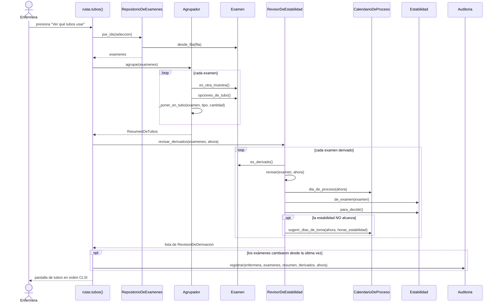
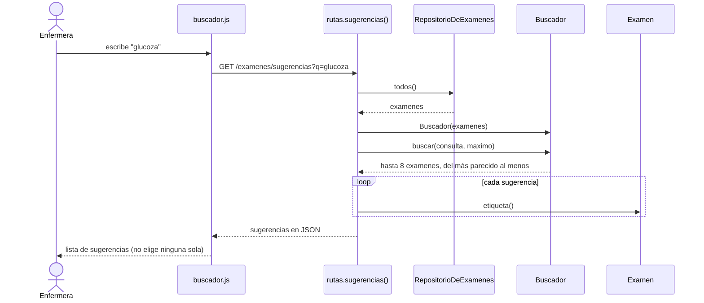
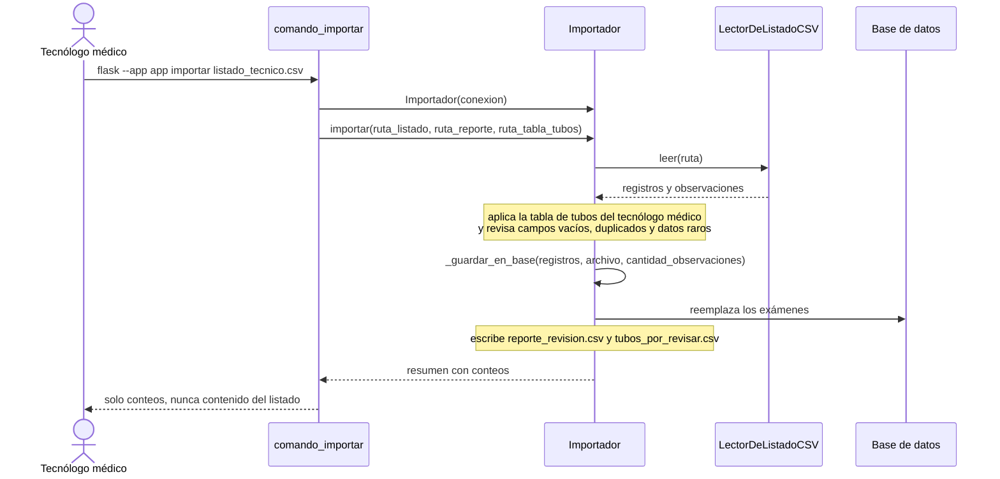
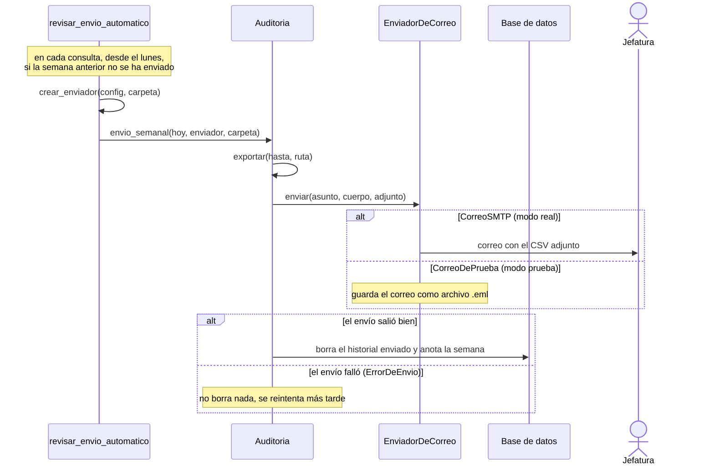

# Diagramas de secuencia

Cada mensaje entre objetos es un método real: aparece en el diagrama de clases
(`clases.md`) y en el código (`app/`). Las rutas (`rutas.py`) son funciones de
Flask que reciben lo que hace la enfermera en el navegador.

## SD-1 Ver qué tubos usar (CU-03, CU-04, CU-09)

## SD-2 Buscar un examen (CU-02)

## SD-3 Importar el listado técnico (CU-06, CU-07)

## SD-4 Envío semanal de la auditoría (CU-08)

`EnviadorDeCorreo` es la clase abstracta: `Auditoria` no sabe si el correo es
de prueba o real (patrón Strategy, ver `clases.md`).
